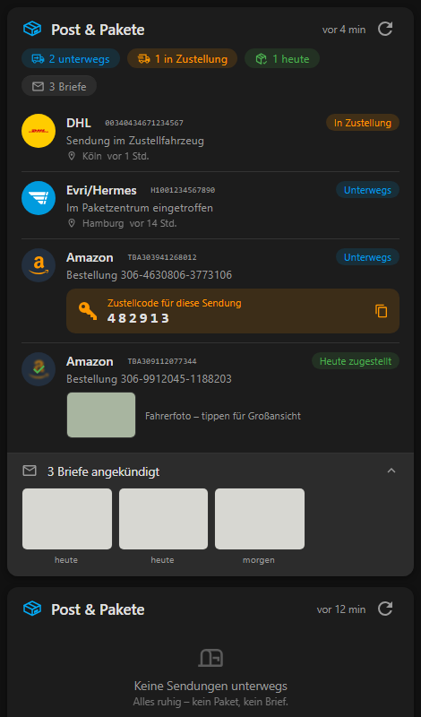

# Mail and Packages Card

A modern shipment-list card for the [Mail and Packages](https://github.com/BMWfan/Home-Assistant-Mail-And-Packages) integration.



_One card, two states: with shipments and letters (top) and when nothing is pending (bottom). Gray boxes are placeholder images — live they show the actual letter scans and driver photo._

Instead of a grid of per-carrier counters, the card shows what actually matters:

- **Shipment list** – one row per shipment with carrier badge, status chip, last tracking event, location and time (powered by the integration's universal tracking / 17track data). Tap a row to open the carrier's tracking page.
- **Summary chips** – packages in transit, delivered today, letters arriving.
- **Amazon delivery codes (OTP)** – shown attached to the matching order, with one-tap copy.
- **Amazon Hub pickup codes**.
- **Driver photo** – thumbnail on the delivered row, tap to enlarge.
- **Letter previews** – expandable row with per-letter images (DHL Briefankündigung) and delivery dates.
- **Scan now** button in the header + relative "last checked" time.
- Clean empty state, automatic dark/light theme support, German + English.

## Zero configuration

All entities are discovered automatically from the entity registry (integration platform `mail_and_packages`). Add the card and you are done:

```yaml
type: custom:mail-and-packages-card
```

### Options

| Option             | Default                             | Description                       |
| ------------------ | ----------------------------------- | --------------------------------- |
| `name`             | `Post & Pakete` / `Mail & Packages` | Card title                        |
| `show_summary`     | `true`                              | Summary chips row                 |
| `show_shipments`   | `true`                              | Shipment list                     |
| `show_letters`     | `true`                              | Letters row                       |
| `letters_expanded` | `false`                             | Expand letter previews by default |

Entity auto-discovery can be overridden per key if ever needed
(`updated`, `universal`, `transit`, `delivered`, `letters`, `amazon`,
`amazon_delivered`, `otp`, `hub`, `scan`, `amazon_camera`, `dhl_camera`):

```yaml
type: custom:mail-and-packages-card
universal: sensor.my_renamed_universal_sensor
```

## Install

### HACS

- Add `https://github.com/BMWfan/Home-Assistant-Mail-And-Packages-Custom-Card` as a custom repository (type **Dashboard**)
- Install "Mail and Packages Custom Card"
- Hard-refresh the browser after updates (Ctrl+Shift+R)

### Manual

Copy `dist/Home-Assistant-Mail-And-Packages-Custom-Card.js` to `config/www/` and add it as a dashboard resource:

```
url: /local/Home-Assistant-Mail-And-Packages-Custom-Card.js
type: module
```

### Docker Compose dev setup (paired with the integration repo)

For local development against a disposable HA instance (no HAOS/Supervisor),
the [integration repo](https://github.com/BMWfan/Home-Assistant-Mail-And-Packages)'s
`docker-compose.yml` (on its own `feature/docker-devcontainer` branch) bind-mounts
this repo's `dist/` directory read-only into the container's `www/` folder. Clone
both repos as siblings (or set `CARD_DIST_PATH` — see that repo's `.env.example`),
then register the resource once via Settings > Dashboards > Resources with URL
`/local/mail-packages-card/Home-Assistant-Mail-And-Packages-Custom-Card.js`
(JavaScript Module). See that repo's `HANDOFF.md` for the full setup.

## Requirements

Requires the Mail and Packages integration **v0.6.0 or newer** (letter image URLs and OTP order mapping in sensor attributes).

## Development and CI

### Node version

Use Node.js `>=22.12.0 <23` (`.nvmrc` is provided):

```bash
nvm use
npm ci
```

### Local commands

```bash
npm run lint
npm run build
npm run test:contract
npm run verify:bundle
npm run verify:metadata
npm run test:smoke
```

Combined non-browser validation:

```bash
npm run ci
```

### Source and bundle contract

- Canonical tracked source for this repository is `src/Home-Assistant-Mail-And-Packages-Custom-Card.js`.
- Distributed file for HACS/runtime remains `dist/Home-Assistant-Mail-And-Packages-Custom-Card.js`.
- `npm run build` performs a deterministic byte-for-byte copy from `src/` to `dist/`.
- `npm run verify:bundle` and PR CI enforce that `src` and `dist` stay identical.

### Test scope and limitations

- Contract tests (`tests/contract`) validate entity discovery, universal/17TRACK rows, OTP/Amazon Hub handling, scan action wiring, image URL rendering paths, EN/DE text behavior, and theme-variable usage.
- Smoke tests (`tests/smoke`) run in Playwright with mocked Home Assistant APIs for render/empty/error/details/language/mobile scenarios.
- These tests do not fully emulate the complete Home Assistant frontend runtime and should be complemented by manual disposable paired integration-card checks.

### Disposable paired Home Assistant (SPEC-003)

See [the paired runner](tests/paired/README.md) for pinned revisions, isolation,
commands and the CI alternative. It uses actual HA/Lovelace and the companion
entity platforms with synthetic coordinator input. The mock browser harness
uses real Lit, but remains a mock HA environment. Neither certifies live IMAP,
DHL or 17TRACK connectivity. Actual execution evidence and open runtime checks
are in [SPEC-003 verification](specs/003-paired-home-assistant/verification.md).

`npm run build` remains a byte-for-byte source mirror copy, not compilation of
modular authored source. A source migration needs a separate approved SPEC.
Runtime source now participates in ESLint's recommended correctness rules; only
legacy unused variables and unnecessary escapes are suppressed in `src/`.
